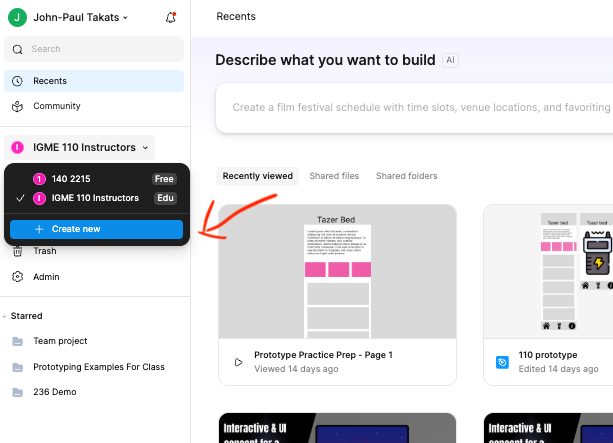
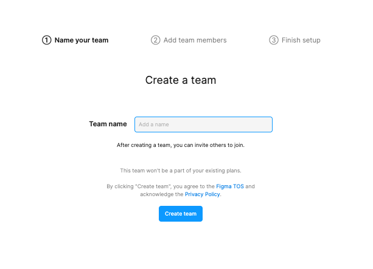
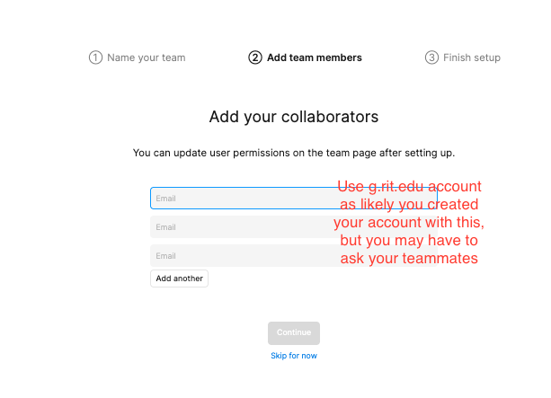
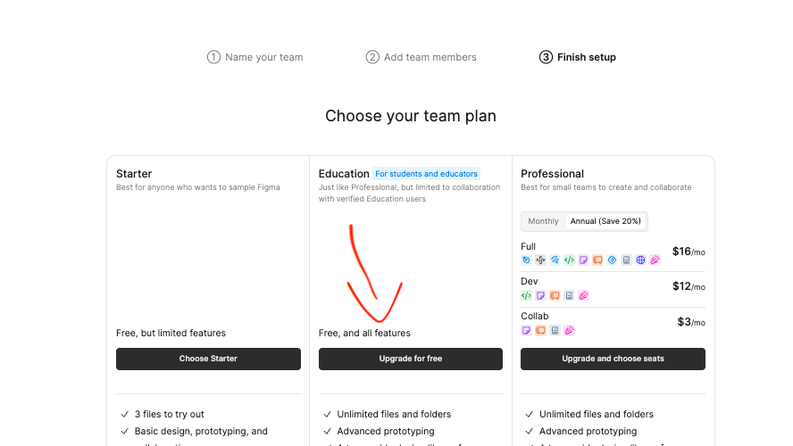

# Week 12A: Hi-Fi Build Day

**Tuesday, November 10**

> **Today in one line:** A quick look at what's coming, then P3 build day
> **Bring:** a laptop, your lo-fi, and your three fixes from testing

Both classes this week are build days. The hi-fi is due Friday night, and
[demo day](../documents/p3-prototype.md#demo-day) on November 17 replaces the team presentations.

## Before you change anything

Screenshot your lo-fi screens. Your write-up shows a lo-fi screen next to its hi-fi version, and
that's hard to do once the lo-fi is gone.

## Setting up your shared Figma file

Do this first. Figma is finicky about shared files, and you don't want to find out the night before
the hi-fi is due. One person does it, usually your Design Lead, and their Figma Education account
has to be approved.

1. **Create a team.** Click your team name at the top left and choose **Create new**.

   

2. **Name it.** Your product name works.

   

3. **Add your teammates by email.** Use their @g.rit.edu address, since that's most likely what they
   signed up with. If an invite doesn't arrive, ask them which email they used.

   

4. **Choose Education** and click **Upgrade for free**. It's free and has every feature.

   

5. **Teammates accept** the invite from their email or their Figma notifications.
6. **Make your hi-fi file inside the new team**, not in Drafts, where teammates may only be able to
   view it. Already made it in Drafts? Right-click the file, choose **Move file**, and pick the team.
7. **Test it.** Everyone adds a shape or their name to the file. If anyone can only view, or gets a
   "request access" screen, fix it before you build.

## What has to change from your lo-fi

Last week the question was whether a stranger could find their way. This week it's whether someone
who has never seen your app would believe it's real.

- **How it looks:** one type pairing, one color palette, the same buttons everywhere.
- **What it says:** real content. No lorem ipsum, and no buttons that just say "Button."
- **What it does:** every task works from start to finish, starting from the home screen.
- **Your three fixes from testing.** Without them, you've just colored in your lo-fi.

You don't need the rest of the app. Three tasks that work beat ten screens that don't connect. The
full list is on the [project page](../documents/p3-prototype.md#4-hi-fi-prototype).

## Friday night

One submission per team on myCourses: the **Figma prototype link**, set so anyone with the link can
view (check it in a private window), and the **[write-up](../documents/p3-prototype.md#the-write-up)**
as one PDF. No presentation, no slides.

You can keep polishing until demo day. Stay in the same Figma file so the link keeps working. I'll
grade after demo day, but I can look any time after Friday, so hand in something solid. The write-up
is final on Friday, because it goes on the Project 4 page that weekend.

## What's coming

Only five class days are left after this week:

- **Fri Nov 13:** Hi-Fi due
- **Tue Nov 17:** Demo day and class vote, then Project 4 starts
- **Thu Nov 19:** Shotcut in class
- **Fri Nov 20:** P4 Work Plan and P3 Peer Eval
- **Tue Nov 24:** Video Production due, Audacity in class
- **Tue Dec 1:** Audacity due
- **Fri Dec 4:** P4 Rough Cut
- **Fri Dec 11:** P4 Final Video

Video Production and Audacity are called activities, but they're really homework that starts in
class. Plan to finish them at home, and come to class for the walkthrough. myCourses is the official
deadline for everything here.

## Due this week

- **P3: Hi-Fi Prototype** · Fri Nov 13
